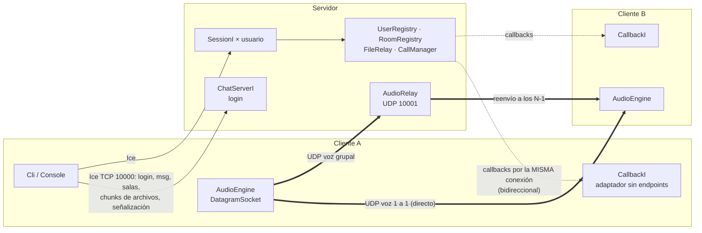

# Chat multimedia con ZeroC Ice + Voz UDP

**Computación en Internet I — Universidad Icesi — Taller 2 (Unidad 2)**

| Integrante | Código | Módulo principal |
|---|---|---|
| _Integrante 1_ | _______ | Contrato Slice, Gradle, sesión/presencia, chat 1 a 1, salas, CLI |
| _Integrante 2_ | _______ | Transferencia de archivos (chunking), llamadas 1 a 1 y grupales UDP |

Plataforma de chat distribuida tipo Discord con dos canales de red:

- **ZeroC Ice (TCP/RPC)**: sesión, presencia, mensajes privados, salas, archivos por bloques y la *señalización* de las llamadas.
- **UDP puro (`DatagramSocket` + `javax.sound.sampled`)**: el audio de las llamadas 1 a 1 (punto a punto) y grupales (relay en el servidor).

Interfaz elegida: **CLI** (opción A). Arquitectura de voz grupal: **Relay centralizado (SFU ligero)**.

---

## 1. Requisitos

| Herramienta | Versión |
|---|---|
| JDK | 11, 17 o 21 (el código compila con `--release 11`) |
| ZeroC Ice | **3.7.10** instalado (el plugin de Gradle necesita `slice2java`) |
| Gradle | No hace falta: se usa el wrapper `./gradlew` (Gradle 8.14.3) |

Instalar Ice 3.7 (solo una vez por máquina):

- **Windows**: instalador MSI *Ice 3.7.10* de zeroc.com (queda en `C:\Program Files\ZeroC\Ice-3.7.10`).
- **Ubuntu/Debian**: repositorio de ZeroC y `sudo apt install zeroc-ice-compilers`.
- **macOS**: Homebrew con el tap de ZeroC (`brew tap zeroc-ice/tap`), instalando la versión 3.7.

Si Ice quedó en otra carpeta, defina la variable de entorno `ICE_HOME` apuntando a ella.

## 2. Compilar y ejecutar

```bash
./gradlew build            # compila Chat.ice → stubs Java y los tres módulos
./gradlew runServer        # servidor: Ice en TCP 10000 + relay de audio en UDP 10001
./gradlew runClient -q     # cliente (en otra terminal; -q deja la consola limpia)
```

En Windows use `gradlew.bat` en lugar de `./gradlew`.

Desde otra máquina del laboratorio:

```bash
./gradlew runClient -q -Phost=192.168.1.20 -Pnick=ana
```

| Propiedad | Uso | Defecto |
|---|---|---|
| `-Phost` | IP del servidor | `localhost` |
| `-Pport` | Puerto TCP de Ice | `10000` |
| `-Pnick` | Inicia sesión automáticamente | — |
| `-PudpPort` | Puerto UDP local del audio (0 = cualquiera libre) | `0` |
| `-Pcolor` | Colores ANSI en la consola | `true` (Linux/Mac), `false` (Windows) |
| `-PtestTone=true` | Si no hay micrófono, envía un tono de 440 Hz (para probar la red) | `false` |
| `-PaudioPort` (servidor) | Puerto UDP del relay | `10001` |

**Firewall**: abra en el servidor TCP 10000 y UDP 10001. En los clientes debe permitirse UDP entrante a Java (Windows lo pregunta la primera vez: marque *Redes privadas*). Use **audífonos** en las llamadas para evitar el eco acústico (el micrófono captura lo que sale por los parlantes).

## 3. Manual de usuario (comandos)

| Comando | Descripción |
|---|---|
| `/login <nick>` | Inicia sesión (2–20 letras, números, `_` o `-`; único, sin distinguir mayúsculas) |
| `/logout` · `/quit` | Cierra sesión · sale del programa |
| `/users` | Usuarios conectados |
| `/msg <nick> <texto>` | Mensaje privado (muestra la hora de confirmación del servidor) |
| `/create <sala>` | Crea una sala y te une a ella |
| `/rooms` | Catálogo de salas (miembros y personas en llamada) |
| `/join <sala>` · `/leave <sala>` | Unirse · abandonar (puedes estar en varias) |
| `/members <sala>` | Miembros de una sala |
| `/say <sala> <texto>` | Mensaje a una sala |
| `/use <sala>` | Cambia la sala activa; **texto sin `/` va a la sala activa** |
| `/sendfile <nick> <ruta>` | Envía un archivo a un usuario |
| `/sendfile #<sala> <ruta>` | Envía un archivo a todos los miembros de una sala |
| `/call <nick>` | Llamada de voz 1 a 1 |
| `/accept` · `/reject` | Contestar · rechazar la llamada entrante |
| `/gcall <sala>` | Iniciar o unirse a la llamada grupal de la sala |
| `/mute` | Silenciar / reactivar el micrófono |
| `/hangup` | Colgar o salir de la llamada grupal |
| `/status` | Estado: sesión, sala activa, llamada y contadores de paquetes UDP |
| `/help` | Ayuda |

Los archivos recibidos se guardan en `client/downloads/<tu-nick>/` (solo después de verificar tamaño y SHA-256).

## 4. Arquitectura



### Flujos

**Login (RF-01)**: el cliente crea un adaptador de objetos *sin endpoints*, registra `CallbackI`, asocia el adaptador a su conexión con el servidor (`connection.setAdapter`) y llama `login(nick, callbackProxy)`. El servidor valida el nick con `putIfAbsent` (si existe lanza `NicknameInUseException`), fija el callback a esa conexión con `ice_fixed`, crea un servant `Session` con identidad UUID y avisa a todos con `userConnected`.

**Mensajes (RF-02/03)**: `sendPrivateMessage` devuelve el timestamp del servidor como confirmación o lanza `UserNotFoundException`. `sendRoomMessage` itera **solo** los miembros de esa sala (aislamiento) y no se envía al emisor. Todas las notificaciones son `xxxAsync`, así un cliente lento no bloquea al servidor.

**Archivos (RF-04)**:

```
cliente A                     servidor                      cliente B
beginFileTransfer(meta) ───▶  valida, crea id  ── fileStarted(meta) ──▶ crea .part
sendFileChunk(id,0,64KB) ──▶  verifica orden   ── fileChunk(id,0,…) ──▶ escribe en offset 0
   … (espera la respuesta antes del siguiente bloque = control de flujo)
endFileTransfer(id,sha) ───▶  verifica total   ── fileFinished(id,sha)▶ verifica SHA-256 → renombra
```

**Llamada 1 a 1 (RF-05)**: `startCall(B, ipA:puertoA)` → B recibe `incomingCall` y A recibe `callRinging` → B hace `/accept` → `acceptCall(id, ipB:puertoB)` → A recibe `callAccepted`. Desde ahí cada uno envía datagramas al otro directamente. `hangup` → `callEnded` al otro. Si nadie contesta en 30 s el servidor cancela la llamada.

**Llamada grupal (RF-06, relay)**: `joinConference(sala, puerto)` devuelve el puerto del relay y un `ssrc` único. El cliente manda su voz al relay; el relay identifica al emisor por el `ssrc` y reenvía el paquete a los demás participantes. Cada cliente mezcla (suma) los flujos que recibe.

**Formato del datagrama de voz**: `[ssrc 4B][seq 4B][PCM 640B]` = 20 ms de audio PCM 16 kHz, 16 bits, mono (256 kbit/s de audio, ≈ 270 kbit/s por flujo con cabeceras IP/UDP). Un paquete de 8 bytes sin audio es un *keep-alive* (lo usa un cliente en mute para que el relay siga conociendo su dirección).

### Concurrencia (thread-safety)

| Estado | Estructura |
|---|---|
| Usuarios conectados | `ConcurrentHashMap<String, ConnectedUser>` + `putIfAbsent` / `remove(key, value)` |
| Salas y miembros | `ConcurrentHashMap<String, Room>`, miembros `ConcurrentHashMap.newKeySet()` |
| Transferencias | `ConcurrentHashMap` + `synchronized(transfer)` para el índice esperado |
| Llamadas / ocupado | `ConcurrentHashMap` + `putIfAbsent` (un usuario no puede estar en dos llamadas) |
| Participantes del relay | `ConcurrentHashMap<Integer ssrc, Participant>` (el hilo UDP lee sin bloquear) |
| Listeners de limpieza | `CopyOnWriteArrayList` |

En el cliente, los callbacks de Ice corren en un único hilo y **nunca** hacen invocaciones síncronas al servidor ni esperan candados que se mantengan durante una invocación (evita interbloqueos). La consola lee en el hilo principal y los eventos se imprimen con un candado que redibuja el prompt.

### Tolerancia a fallos

- **Logout** limpia sesión, salas, transferencias y llamadas y avisa a todos.
- **Caída abrupta**: el cliente envía heartbeats (ACM) cada pocos segundos; si el proceso muere la conexión TCP se cierra (o el servidor la cierra a los 30 s sin heartbeats) y el `CloseCallback` de la conexión ejecuta la misma limpieza. Un callback que falla con error de conexión también expulsa al usuario.
- Si un emisor se cae a mitad de un archivo, los receptores reciben `fileAborted` y borran el `.part`.

### Estructura del repositorio

```
chat-ice/
├── build.gradle · settings.gradle · gradle.properties · gradlew · gradlew.bat · gradle/
├── common/                       contrato y clases compartidas
│   ├── build.gradle              plugin com.zeroc.gradle.ice-builder.slice
│   └── src/main/slice/Chat.ice   ← contrato Slice
│       src/main/java/common/Protocol.java
├── server/  (config.server)
│   └── src/main/java/server/
│       ServerMain · ServerContext · ChatServerI · SessionI · ConnectedUser · Log
│       UserRegistry · RoomRegistry · FileRelay · CallManager · AudioRelay
└── client/  (config.client)
    └── src/main/java/client/
        ClientMain · ChatClient · CallbackI · Cli · Console
        FileSender · FileReceiver · CallController · AudioEngine
```

---

## 5. Cuestionario de análisis conceptual

### 5.1 Arquitectura híbrida TCP/UDP

El texto, el control y los archivos necesitan **exactitud y orden**: un mensaje incompleto o un byte cambiado en un PDF son errores. TCP (debajo de Ice) da entrega confiable, ordenada y control de congestión, e Ice añade contratos tipados, excepciones y despacho a objetos. Que tarde unos milisegundos más no importa.

La voz necesita lo contrario: **puntualidad**. Una trama de 20 ms que llega tarde ya no sirve; es mejor perderla y reproducir silencio (casi imperceptible) que esperarla. UDP envía cada trama de forma independiente, sin retransmisiones ni orden forzado, así la latencia queda acotada.

Si la voz fuera por Ice/TCP con *jitter* o pérdida:

- **Bloqueo de cabeza de línea (head-of-line blocking)**: si se pierde un segmento, TCP retiene todos los posteriores hasta retransmitirlo (≥ 1 RTT, a veces cientos de ms). El audio se congela y luego llega de golpe.
- **Latencia acumulada**: tras cada congelamiento el receptor queda atrasado; para no cortar hay que agrandar el buffer, y la conversación se vuelve "tipo walkie-talkie".
- **Control de congestión**: ante pérdidas TCP reduce la ventana y el emisor no puede sacar el audio al ritmo que se genera (se acumula en buffers).
- **Sobrecarga**: cabeceras de Ice + ACKs + invocaciones síncronas por cada trama (50 por segundo) y, si la invocación es síncrona, el emisor queda bloqueado esperando la respuesta.
- Resultado acústico: cortes, robotización, ráfagas aceleradas y retrasos crecientes. Con UDP una pérdida del 1–2 % solo produce pequeños "clics" casi inaudibles.

### 5.2 Buffer y chunking en Ice

`Ice.MessageSizeMax` limita el tamaño de un mensaje (por defecto **1024 KB**). Si se envían 80 MB en un solo `sequence<byte>`, el lado que **recibe** lee la cabecera del mensaje, ve que excede el límite y lanza `Ice::MemoryLimitException`; además cierra la conexión. El emisor no recibe una respuesta normal sino una excepción de conexión (`ConnectionLostException` / `SocketException`; lo comprobamos enviando 80 MB a nuestro servidor: el cliente obtuvo `SocketException: Connection reset by peer` y su sesión se cerró). Aunque se subiera el límite, el mensaje entero (80 MB) tendría que estar en memoria en ambos lados y en el servidor por cada destinatario, y una falla a mitad obliga a reenviar todo.

**Fragmentación**: el archivo se divide en bloques de 64 KB (`Protocol.CHUNK_SIZE`). Cada `sendFileChunk(id, índice, datos)` es un mensaje pequeño, muy por debajo del límite. Los metadatos (nombre, tamaño total, tamaño de bloque, total de bloques) viajan en `beginFileTransfer`, y el SHA-256 en `endFileTransfer`. Ventajas: memoria acotada, progreso visible, validación de orden por índice, la conexión no se monopoliza (los chats siguen fluyendo entre bloques) y control de flujo (el servidor responde un bloque cuando los destinatarios lo recibieron).

Parámetros de configuración que intervienen:

- `Ice.MessageSizeMax` (KB) — límite por mensaje; lo dejamos en 2048 en ambos lados como margen.
- `Ice.Default.InvocationTimeout` — tiempo máximo de cada invocación (20 s en el cliente).
- `Ice.ThreadPool.Server.Size/SizeMax` — hilos que despachan bloques concurrentes de varios usuarios.
- `Ice.ACM.*` — mantiene viva la conexión durante transferencias largas.
- (opcional) `Ice.Override.Compress` / proxies con `ice_compress` para comprimir.

### 5.3 Escalabilidad: Relay vs. Mesh

Con **N participantes hablando a la vez**, cada uno genera 50 tramas/s (20 ms). Por cada intervalo de 20 ms:

| | Paquetes que **emite cada cliente** | Paquetes que **recibe cada cliente** | Carga UDP en el **servidor** |
|---|---|---|---|
| **Relay (nuestra elección)** | **1** (al relay) | N − 1 | recibe **N**, envía **N·(N−1)** → total N² |
| **Mesh P2P** | **N − 1** (uno a cada par) | N − 1 | **0** (solo señalización Ice) |
| Total en la red | N·(N−1) en mesh | | N + N·(N−1) = N² en relay |

Ejemplo con N = 5 y ≈ 270 kbit/s por flujo (648 B + 28 B de cabeceras IP/UDP, 50 paquetes/s):

- **Relay**: cada cliente sube 270 kbit/s y baja 1,08 Mbit/s; el servidor recibe 1,35 Mbit/s y envía 5,4 Mbit/s (100 % de la carga en él).
- **Mesh**: cada cliente sube 1,08 Mbit/s y baja 1,08 Mbit/s; el servidor no toca audio.

Análisis: la subida del cliente en mesh crece linealmente con N (las conexiones domésticas tienen poca subida) y cada cliente debe conocer y alcanzar a todos los demás (problemas de NAT/firewall entre pares). El relay mantiene al cliente con una sola subida y un solo destino, controla quién recibe qué (aislamiento por sala, sin eco al emisor) y aprende la dirección real del cliente, pero el servidor se vuelve cuello de botella y punto único de falla, con salida O(N²) en total. Para un laboratorio con decenas de usuarios el relay es más robusto; para salas grandes la industria usa SFU con mezcla o selección del hablante activo.

### 5.4 Transparencia y callbacks en Ice

**Ciclo de vida en el cliente:**

1. `Util.initialize()` crea el *communicator*.
2. `communicator.createObjectAdapter("")` crea un adaptador **sin endpoints** (el cliente no escucha en ningún puerto TCP).
3. `adapter.add(new CallbackI(), identidad)` registra el servant y devuelve un proxy; `adapter.activate()`.
4. `server.ice_getConnection().setAdapter(adapter)` asocia el adaptador a la conexión saliente: las peticiones que lleguen por ella se despachan a ese adaptador (**conexión bidireccional**).
5. `login(nick, callbackPrx)`: el servidor recibe el proxy y lo fija a la conexión con `ice_fixed(current.con)`.
6. El servidor invoca `callbackPrx.xxxAsync(...)`; viaja por la misma conexión TCP y se ejecuta en el pool de hilos cliente.
7. En `logout`/cierre, el servidor descarta el proxy y destruye el servant `Session`; al salir, `communicator.destroy()` cierra todo.

**Proxies directos vs. indirectos:**

- **Directo**: contiene la identidad y los *endpoints* (`ChatServer:tcp -h 10.0.0.5 -p 10000`). Es lo que usa el cliente para llegar al servidor. Si el cliente registrara su callback en un adaptador con endpoints (`tcp -p 0`), el servidor recibiría un proxy directo y abriría una **nueva conexión hacia el cliente**: falla si el cliente está detrás de NAT o firewall (muy común en Windows).
- **Indirecto**: solo identidad (`ChatServer`) o identidad + *adapter id* (`ChatServer@ChatAdapter`); un **Locator** (IceGrid) traduce a endpoints en tiempo de ejecución, lo que permite mover servidores sin cambiar clientes (transparencia de ubicación).
- **Fijo (fixed)**: el que usamos para los callbacks. El proxy que manda el cliente no tiene endpoints; el servidor lo convierte con `ice_fixed(conexión)` en un proxy atado a la conexión ya abierta. No hace falta abrir puertos en el cliente, y si esa conexión se cae el proxy deja de funcionar, lo que aprovechamos para detectar desconexiones.

---

## 6. Bitácora de uso ético de IA generativa (Nivel 3)

> Completar con la experiencia real del equipo.

| # | Prompt / consulta principal | Qué se generó | Qué adaptamos críticamente | Lección aprendida |
|---|---|---|---|---|
| 1 | Explicación del taller y propuesta de arquitectura | Diseño de contrato Slice y módulos | | |
| 2 | Código base servidor/cliente | | | |
| 3 | Depuración de … | | | |

## 7. Pruebas sugeridas para la sustentación

1. Servidor en una máquina, 3 clientes en otras (`-Phost=<IP>`).
2. Login repetido con el mismo nick → `NicknameInUseException`.
3. `/msg` a un usuario inexistente → error descriptivo.
4. Dos salas; verificar que los mensajes de una no llegan a la otra.
5. `/sendfile #sala` con una imagen y un archivo de 20–80 MB; comparar el SHA-256 (`certutil -hashfile archivo SHA256` / `sha256sum`).
6. `/call`, `/accept`, `/mute`, `/hangup`; `/status` muestra los paquetes UDP.
7. `/gcall` con 3 participantes; uno sale sin cortar a los demás.
8. Cerrar un cliente a la fuerza (cerrar la ventana): los demás ven `- nick se desconectó`.
